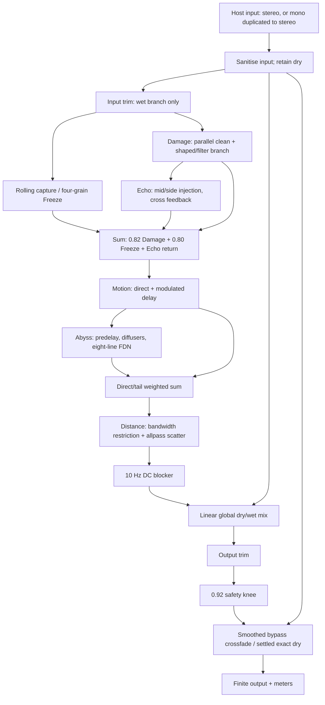

# FROSTBITE DSP, gain staging and sonic character audit

Audit date: 21 October 2026. Baseline repository: `6023ac3905be5628b5deb07c64a75c2608e0dd2c`. Windows x64 Release, JUCE 9.0.4, C++20. The source, measurements and tests establish the findings below. No subjective audition or Studio One listening improvement is claimed.

## Findings that explain the reported symptoms

1. **Dry unity works at Output = 0 dB; the shipped default is −3 dB.** Bypass and settled Mix = 0 / Output = 0 are sample-exact for valid inputs in the supported numerical range. Mix = 0 with the default Output is exactly 3 dB quieter for signals below the output safety knee. Input trim affects only the wet branch; Output affects both branches before bypass.
2. **The wet path contains explicit, cumulative attenuation.** Its direct layer starts at `0.82` (−1.72 dB), then Abyss/Distance reduce that layer, Distance restricts bandwidth and adds phase dispersion, and Output applies another −3/−5 dB in factory presets. With all effect macros at zero, Mix = 100% and Output = 0 dB, measured 1 kHz gain is −1.72 dB. Zero macros therefore do not mean neutral wet unity. This fixed calibration is retained as existing voicing, not silently relabelled an accidental arithmetic bug; the original motivation for choosing .82 is not documented.
3. **Damage has substantial drive and harmonics, but its character is constrained.** Both modes are soft saturators. Maximum combined drive is 54 dB, followed by up to −27 dB compensation. At default fine Drive, raising Damage from 25% to 100% changes the −18 dBFS 1 kHz third harmonic from −37.5 to −15.7 dBc. It is not failing to engage. The effect depends strongly on input level, its parallel blend and subsequent ambience/filtering. Frozen audio bypasses Damage entirely.
4. **Abyss has a real, stereo, multi-second tail, with low broadband impulse-return energy and much shorter high-frequency decay.** At 48 kHz, increasing Abyss 0→100% changes measured T20-extrapolated RT60 from 2.60→9.34 s, against nominal targets of 3.15→13.50 s. The >2 kHz band reaches only 2.42 s at maximum. Raw integrated impulse energy changes less than 1 dB across this sweep. Filters, injection/readout gain and downstream Distance contribute to its restrained presence. This does not establish that a replacement reverb is needed.
5. **High Freeze values do nothing until audio is captured.** All factory presets load unarmed. Captured Freeze joins after Damage and Echo, so sweeping those controls cannot destroy or echo a held layer once live input stops. This is a consequential architectural limitation for the requested industrial extreme.
6. **Two demonstrated routing/automation defects were fixed:** Distance no longer bypasses the fine Reverb Level control, and the exact-dry shortcut no longer skips Output smoothing when its target returns to 0 dB. Neither fix is a gain boost or a redesign of the current sound.

The appropriate next pass is gain calibration followed by controlled Damage/reverb voicing work, with preserved legacy behavior. See [SONIC_ROADMAP.md](SONIC_ROADMAP.md).

## Actual signal flow

Derived from `Source/dsp/Engine.cpp`, especially `Engine::processImpl` (line 319), not from UI labels. Every branch runs even when its return is muted, preserving internal state/tails.



This is a hybrid parallel/series architecture. Echo receives Damage only; reverb receives the entire summed/moving layer. There is no reverb-to-Echo feedback. Damage is not placed after Freeze or after the reverb.

Let `R = ReverbLevel × Abyss^0.8`, `E = EchoLevel × 0.85 × Echo^1.15`, `D = Distance`, `T = ReverbLevel`, `F = Freeze^1.25 × dB(FreezeLevel)` and `m = Mix`. Post-fix summing is:

```text
source = dry × dB(Input)
ice = Freeze(source, Capture) × F
coloured = Damage(source)
layer = Motion(0.82 × coloured + 0.80 × ice + E × Echo(coloured))
tail = Reverb(layer)
wet = DC10(Distance(layer × (1 − 0.38R − 0.22D)
                  + tail × (R × (0.8 + 0.35D) + 0.22D × T)))
out = protect(((1 − m) × dry + m × wet) × dB(Output))
out = blend(out, dry, bypassFade)
```

The old final tail term was `+0.22D`, without `T`. The exact-dry exceptions and finite-input bounds described below also apply.

| Stage / code | Gain, filtering and nonlinear behavior | Stereo / state / latency |
|---|---|---|
| Host adapter, `PluginProcessor.cpp:22` | APVTS values, BPM fallback 120, no automatic input normalisation | Mono input copied to both output channels; stereo retained; stereo output only. Reports 0 samples latency. |
| Input, `Engine.cpp:325` | NaN/Inf → 0; finite samples clamped to ±32. Input −24…+12 dB affects wet only | Dry remains original sanitised input. No added delay. |
| Freeze, `Engine.cpp:197` | 1.5 s rolling capture, four Hann grains, sum divided by window-weight sum; seam taper 5 ms; gain `F`, then 0.80 in sum | Shared stereo grain positions. Capture on rising edge after >8 recorded samples; 60 ms attack/recapture crossfade, 180 ms release. No captured audio in saved state. |
| Damage, `Engine.cpp:84` | Clean/shaped blend; drive, ADAA, biased/odd saturation, `1/sqrt(drive)` compensation, 15 Hz DC blocker and one-pole LPF | Channels processed separately with identical settings. ADAA has half-sample averaging character only in shaped branch; no fixed whole-plugin latency. |
| Echo, `Engine.cpp:114` | Mid/side injection into two delay lines; cross feedback through 25 Hz DC blockers, LPFs and `tanh`; feedback ≤0.94. Return scaled by E | Mono input initially repeats left, then right. Width 0…1.5. Musical delay 20 ms…12 s; time changes crossfade 60 ms. |
| Layer sum | 0.82 direct, 0.80 frozen, plus scaled echo; both constructive and destructive summation possible | Freeze does not enter Echo or Damage. |
| Motion, `Engine.cpp:261` | Blend of layer with linearly interpolated ~8 ms delay; mix `0.5 × Motion × MotionDepth`; excursion ±2.5 ms × depth | L/R modulation phases differ by 1.7 rad. Rate 0.03…2 Hz; potential combing/phase cancellation is intentional chorus behavior. |
| Reverb, `Engine.cpp:145` | Predelay → four input allpasses per channel → eight unequal delays; injection ±0.24; orthogonal Householder feedback, per-line loss, LPF/35 Hz DC blockers; return coefficient 0.44 | Phase-offset modulation, different L/R diffusion times and output taps. Musical predelay/tail, not compensatable global latency. |
| Direct/tail sum | Direct coefficient `1−.38R−.22D` stays nonnegative (minimum .40). Tail coefficient up to 1.37 at fine level one | Raises diffuse/direct ratio without guaranteeing energy or loudness conservation. |
| Distance, `Engine.cpp:270` | 70 Hz HP + exponential LPF 16 kHz→1.04 kHz; allpass g=.60. Nested blend `(1−D)x + D[(1−.42D)dark + .42D AP(dark)]` | Scatter lengths 11.3 / 14.9 ms; mixes phase-rotated versions, producing frequency-dependent losses. |
| Wet DC filter | 10 Hz single-pole DC blocker on the whole wet branch | Alters low-frequency phase/gain even at zero macros. |
| Mix / Output | Correlated linear mix, then −24…+6 dB trim | Dry included in Output trim. No pan law or hidden stereo-normalisation gain. |
| Protection / bypass | Linear through amplitude .92; above it `.92+.08*tanh((abs(x)−.92)/.08)`. Bypass fade uses 25 ms smoother | Settled bypass is exact dry; settled Mix=0 and Output=0 also restores exact dry, including finite over-full-scale input. This exception intentionally bypasses protection. |

Continuous values use `1−exp(−1/(sampleRate×.025))` smoothing, with mapped coefficients refreshed every 32 samples. Capture uses its unsmoothed edge, sync/division are discrete, Character morphs through smoothing. Size has another fixed `.004` coefficient per control update. First processing initializes from targets, avoiding a startup ramp from unrelated defaults.

## Measurement method and reproducibility

The existing `Tools/Render.cpp` now accepts `--audit DIRECTORY`; `Tools/Audit.h` supplies the suite. `Engine::processOffline` records 14 preallocated stage frames using the same templated processing body as production. `processImpl<false>` compiles tracing out of the real-time callback. A sample-exact parity test verifies both paths. Analysis and file I/O occur only offline.

Each run contains **508 matrix rows and 7,112 stage rows**, plus isolated Damage and reverb measurements:

- Silence, impulse, 100 Hz / 1 kHz / 5 kHz sines, five-tone input (83/251/997/3001/7001 Hz), deterministic white and approximate Voss-McCartney pink noise, synthetic piano transients and cello harmonics.
- −18 and −6 **sample-peak dBFS**. Each synthetic signal is peak-normalised independently; these are not equal-RMS sources or recorded instruments. The silence level field is the requested target, not a measured nonzero level.
- Main matrix: 48 kHz, 256 samples, four seconds active plus two seconds tail; bypass, dry default/unity, minimum macros at 0/50/100% Mix, Init at 55/50/100% Mix, Damage/Abyss/Echo maximum, all eight factory presets and a captured Frozen Cello case.
- 44.1/48/96 kHz, 1/64/257/1024-sample blocks for additional Init/dry/extreme multitone coverage; regression tests cover further layouts, blocks, silence, automation and nonfinite input.
- Quarter-step macro sweeps with isolated macro variation and captured Freeze; raw Damage at 0/25/50/75/100%, two levels, 1 kHz and 7,301 Hz, at all three rates; 40-second raw reverb IRs at all three rates and five Abyss settings; 30-second full-chain IR tails.
- Per-stage peak, RMS, gain relative to input, DC, full-scale sample count, invalid count and stereo correlation. Post-fix CSV adds separate left/right DC. `dry_wet_cosine` measures the energy-normalised dry/wet dot product, not Pearson correlation. `clips` counts channel samples at `|x|≥1`; it does **not** count all safety-knee activity. Compare `mixed` and `protected` stages for that.

Matrix RMS is over the **active input window including startup**, not a settled-frequency response or perceived loudness measurement. The 10 ms active window of `long_impulse` rows excludes late reverb; analyse the WAV/`chain_ir.csv` for tails. Capture is block-aligned after 1.5 s; continuous-material tests exercise it, but the original impulse is no longer in that rolling window and these are not captured-impulse experiments.

`Tools/analyse_audit.py` uses a coherent last-one-second FFT for harmonics, Schroeder backward integration and a −5…−25 dB least-squares T20 fit extrapolated to 60 dB for IR decay. Band decays use fourth-order Butterworth analysis filters (overlapping bands, not an exact energy partition). Reported spectral prominence is a local PSD-median comparison in the 0.2–2 s tail, a ringing indicator rather than a perceptual metallicity score. Density is the fraction of samples exceeding local RMS; it is not a psychoacoustic echo-density standard.

WAVs are stereo 24-bit PCM. Reverb fits use the available 40-second, quantised response; nominal feedback RT60 and measured decay are distinct. A 1 kHz waveform can fold aliases onto harmonic bins, so the separate 7,301 Hz probe measures non-harmonic residual (also including numerical/quantisation noise). It is not a perfect isolated alias-power measurement or a substitute for an oversampled reference.

`*_rms_minus24.wav` files are scaled to −24 dBFS RMS over their active window, with no independent peak normalisation. The tool refuses any matched file that would clip. This is a controlled level comparison, **not LUFS or perceived-loudness matching**. All eight presets have piano/cello original-level and matched examples. No claims about subjective similarity, heaviness or spaciousness follow from RMS alone.

Reproduce after building:

```powershell
./scripts/build.ps1 -Configuration Release -Jobs 3 -RenderDirectory "$PWD/renders/audit/pipeline"
./build/frostbite_render_artefacts/Release/frostbite_render.exe --audit "$PWD/renders/audit/after"
python Tools/analyse_audit.py renders/audit/after --before renders/audit/before
```

Python analysis requires NumPy, SciPy and Matplotlib (available here: 2.1.3 / 1.14.1 / 3.10.0). Baseline executable is preserved as `build/audit/frostbite_render_before.exe`, captured after trace instrumentation but before either DSP fix. It can regenerate `before` independently. Baseline CSV has stereo-averaged DC and uses −300 dB as a placeholder for silence gain; silence gain is undefined, and the new renderer writes NaN for that ratio. The audio-generation methodology is identical.

## Gain staging results

The following are active-window RMS gain relative to −18 dBFS peak input, 48 kHz. Default/factory measurements retain the shipped Output values. Minimum-macro rows explicitly set Output = 0 dB.

| Configuration | 100 Hz | 1 kHz | 5 kHz | White noise | Cello |
|---|---:|---:|---:|---:|---:|
| Bypass | 0.00 | 0.00 | 0.00 | 0.00 | 0.00 |
| Mix 0, Output 0 | 0.00 | 0.00 | 0.00 | 0.00 | 0.00 |
| Mix 0, default Output −3 | −3.00 | −3.00 | −3.00 | −3.00 | −3.00 |
| All macros 0, Mix 50 | −0.85 | −0.82 | −0.82 | −0.82 | −0.83 |
| All macros 0, Mix 100 | −1.76 | −1.72 | −1.72 | −1.72 | −1.74 |
| Init, Mix 55 | −3.14 | −5.13 | −5.23 | −6.04 | −3.82 |
| Init, Mix 100 | −2.83 | −6.59 | −7.41 | −9.40 | −4.36 |
| Init + Damage 100 | +0.47 | −2.23 | −5.35 | −6.22 | +0.55 |
| Init + Abyss 100 | −6.08 | −5.07 | −6.09 | −6.68 | −5.85 |
| Init + Echo 100 | −0.47 | −3.34 | −3.95 | −5.76 | −1.69 |

Default cello trace, each value relative to input RMS:

| Stage | Gain dB |
|---|---:|
| Input trim | 0.00 |
| Damage output | +1.11 |
| Sum before Motion | +0.46 |
| Sum after Motion | +0.28 |
| Raw reverb return | −5.43 |
| Direct/reverb sum | −0.72 |
| After Distance | −1.34 |
| After wet DC blocker | −1.36 |
| After global Mix + Output | −3.82 |
| After protection / final | −3.82 |

This trace separates loss in the chain from input starvation. Damage is fed unity-trimmed input and can amplify low-level material. Defaults map to 8.88 dB drive, 22.7% Damage blend, 7.05 kHz Damage tone, 17.3% Echo return, 62.0% reverb return, 8.84 s nominal decay, 3.07 kHz feedback damping, Distance LPF 8.77 kHz and only 3.5% delayed Motion blend. The default direct coefficient after layer scaling/Abyss/Distance is 0.587 before filtering; return correlation determines what it becomes after summation.

### Mix law and phase

Keep the current **linear** law. The neutral wet path remains almost fully correlated with dry (cosine approximately 1); Init ranges approximately 0.85–0.96 on the listed material. Equal-power mixing would not cure the underlying calibration and can boost correlated signals. For equal-RMS inputs at 50% Mix:

| Dry/wet correlation | Linear power / gain | Equal-power power / gain |
|---|---|---|
| 1 (same waveform) | 1 / 0 dB | 2 / +3.01 dB |
| 0.5 | .75 / −1.25 dB | 1.5 / +1.76 dB |
| 0 (decorrelated) | .5 / −3.01 dB | 1 / 0 dB |

For unequal branch RMS, `Pout=(1−m)^2 Pd + m^2 Pw + 2m(1−m)ρ sqrt(Pd Pw)`, before Output and protection. This explains why no single mix law simultaneously preserves loudness for all textures. Added regression coverage verifies the exact linear midpoint with correlated, partial-reverb and captured-noise material.

[JUCE DryWetMixer](https://docs.juce.com/master/classjuce_1_1dsp_1_1DryWetMixer.html) provides linear and other rules plus wet-latency compensation; the checked-in JUCE implementation confirms the same linear coefficients. The existing equivalent law is correct and does not need replacement merely to use that class. Musical predelay, echo and chorus must not be globally compensated away. A future oversampled distortion path needs explicit alignment and host-latency testing; today's hybrid direct/shaped branches do not have one fixed wet latency to compensate.

## Damage characterization

With `g=10^((Drive+24×Damage)/20)`, the input to the shaper is bounded at ±100. Warm uses `f(x)=x/sqrt(1+x²)` and primitive `sqrt(1+x²)`. Broken uses `f(x)=x/(1+|x|)` with primitive `|x|−log1p(|x|)`, bias +0.36, subtraction of the bias output and gain 1.65. The output morphs between their first-order antiderivative difference quotients; near equal samples it evaluates the midpoint instead. Both curves are smooth bounded saturation, not hard clipping or foldback. The Broken asymmetry generates even harmonics; its curve can have a bias-dependent negative asymptote before the DC filter.

Post-shaper gain is `1/sqrt(max(1,g))`, followed by 15 Hz DC filtering and a one-pole tone LPF. There is no pre-emphasis, envelope conditioning, bit-depth reduction, sample-rate reduction or oversampling. ADAA reduces aliases but introduces averaging/phase effects and does not remove all foldover ([original DAFx analysis](https://www.dafx.de/paper-archive/2016/dafxpapers/20-DAFx-16_paper_41-PN.pdf)).

Default fine Drive=6 dB, DamageTone=7500 Hz, DamageBlend=1. At 48 kHz / −18 dBFS peak 1 kHz:

| Damage | Total drive dB | Shaped blend | Output RMS dBFS | H2 dBc | H3 dBc | In-band THD dB |
|---|---:|---:|---:|---:|---:|---:|
| 0% | 6 | 0 | −21.01 | below −140 | below −140 | −129.4 (numerical floor) |
| 25% | 12 | .379 | −18.71 | below −140 | −37.51 | −37.50 |
| 50% | 18 | .616 | −16.47 | below −140 | −24.91 | −24.86 |
| 75% | 24 | .818 | −15.06 | −26.83 | −18.31 | −17.44 |
| 100% | 30 | 1 | −14.37 | −24.15 | −15.73 | −14.59 |

`harmonics.csv` contains H1–H12, both input levels and all sample rates. At −6 dBFS peak the maximum-Damage output RMS is −12.36 dBFS versus dry −9.01 dBFS: it is 3.35 dB quieter despite substantial distortion (H3 −12.76 dBc). At −18 dBFS it is 6.64 dB louder than dry. Compensation is therefore **input-dependent in effect**, not evidence that every distorted signal is quiet.

At 7,301 Hz / 48 kHz, non-harmonic residual at maximum Damage is −33.95 dBc (−18 dBFS input) and −29.28 dBc (−6 dBFS). This demonstrates significant folded/numerical content relative to the fundamental under bright high-drive conditions; it does not alone establish audibility or isolate aliasing perfectly. At 25% Damage those values are −85.84 / −52.36 dBc. A future sharper shaper needs a higher-rate reference and an oversampling/ADAA trade-off test.

The likely weak-character contributors are low default shaped blend, progressive tone darkening, bounded soft curves, strong high-drive compensation, the clean global mix, later filtering/ambience masking, and Freeze bypassing Damage. The drive mapping reaches its full documented +24 dB macro range. No drive multiplier or subjective transfer-function change was made.

## Abyss characterization

Predelay 0…150 ms feeds four allpasses per channel at 4.7/7.9/12.7/17.3 ms (right ×1.113). Their coefficient is `.15+.58×mappedDiffusion`. Eight FDN times are 29.7/37.1/41.1/43.7/53.1/61.7/71.9/83.3 ms multiplied by `.55+2×size`. Each line receives alternating L/R diffused input with signs ++++---- and amplitude .24. Feedback uses the orthogonal reflection `I−(1/4)11ᵀ`, line-specific gains `min(.9985,.001^(delaySeconds/targetDecay))`, lowpass damping and 35 Hz highpass filtering. Output is `.44×(tap0+tap2−tap4−tap6)` on left and the odd-index equivalent on right.

Delay taps modulate at .071+.013×lineIndex Hz, phase spacing .79 rad, depth up to .48 ms. Default mapped depth is .1776 ms. There is no separate early-reflection tap network. Input diffusion and FDN arrivals develop density; stereo spread comes from unequal delays, injection and readout rather than a reverb width control. Echo Width does not control Abyss width.

Raw algorithm IRs below use default fine controls and a mono −6 dBFS impulse, measured at 48 kHz. **Return scaling by Abyss and the rest of the chain is excluded**; the 0% row characterizes the running algorithm even though Abyss's own return gain is zero.

| Abyss | Nominal decay s | Measured T20→RT60 s | >2 kHz T20→RT60 s | Onset ms | Integrated return/input energy dB | L/R correlation |
|---|---:|---:|---:|---:|---:|---:|
| 0% | 3.15 | 2.60 | 1.47 | 67.48 | −17.24 | −.022 |
| 25% | 5.74 | 4.50 | 2.03 | 72.67 | −16.44 | .005 |
| 50% | 8.33 | 6.28 | 2.30 | 77.88 | −16.26 | .012 |
| 75% | 10.91 | 7.89 | 2.44 | 83.06 | −16.32 | −.034 |
| 100% | 13.50 | 9.34 | 2.42 | 88.27 | −16.60 | −.039 |

Broadband fit R² is >.999 for these rows. At maximum Abyss, low/mid/high independent-filter energy fractions are .136/.695/.178 and band decay estimates 9.87/9.30/2.42 s. Damping increases with Abyss; this makes the long tail predominantly low/mid-frequency. Integrated impulse energy is not sustained-tone gain: resonance and coherent excitation can yield very different results.

Energy before 80 ms is extremely small (early/late −30 to −36 dB at low/mid settings), and zero at high settings because first FDN arrival is later than 80 ms. This is an absolute timing boundary, not proof of poor early-reflection balance after arrival. In 200–300 ms windows, about 25–28% of samples exceed local RMS; the 30–80 ms interval is sparse or silent. The reverb develops density, but these proxies alone cannot declare it insufficiently diffuse. Tail spectral plots and local PSD prominence identify modes for later listening; no unverified claim of audible metallic ringing is made.

The FDN's orthogonal mixing, bounded nominal loop gains, filters and long-tail stress test support stability for tested settings. An impulse-energy loss of ~16–17 dB plus a return subsequently filtered by Distance can make the space unobtrusive, while long decay alone does not make it louder. Raising Abyss simultaneously lowers the direct layer, lengthens the lines/decay and darkens the feedback. Those coupled choices merit calibration before algorithm replacement.

## Macro mapping and interactions

`mapParameters` is in `Source/dsp/Engine.cpp:58`; 34 IDs/ranges remain unchanged. `macro_map.csv` records every mapped field at 0/25/50/75/100%, varying one macro with other parameters at Init. The selected values below use default fine controls.

| Internal quantity | 0% | 25% | 50% | 75% | 100% |
|---|---:|---:|---:|---:|---:|
| Freeze gain before .80 layer factor | 0 | .177 | .420 | .698 | 1 |
| Damage total drive, dB | 6 | 12 | 18 | 24 | 30 |
| Damage shaped blend | 0 | .379 | .616 | .818 | 1 |
| Damage Broken morph | 0 | 0 | 0 | .444 | 1 |
| Damage LPF, Hz | 7500 | 6563 | 5625 | 4688 | 3750 |
| Distance LPF, Hz | 16000 | 8079 | 4079 | 2060 | 1040 |
| Distance allpass weight (.42D²) | 0 | .0263 | .105 | .2363 | .42 |
| Echo return | 0 | .173 | .383 | .611 | .85 |
| Echo feedback | .299 | .339 | .380 | .420 | .460 |
| Echo LPF, Hz | 5500 | 4744 | 3988 | 3231 | 2475 |
| Abyss return | 0 | .330 | .574 | .794 | 1 |
| Abyss size | .390 | .478 | .565 | .653 | .740 |
| Abyss nominal decay, s | 3.15 | 5.74 | 8.33 | 10.91 | 13.50 |
| Abyss damping, Hz | 3750 | 3441 | 3131 | 2822 | 2513 |
| Motion main depth | 0 | .0875 | .175 | .2625 | .350 |
| Motion reverb-mod contribution + fine .30 | .30 | .388 | .475 | .563 | .650 |
| Mix wet coefficient | 0 | .25 | .50 | .75 | 1 |
| Output, dB at knob travel | −24 | −16.5 | −9 | −1.5 | +6 |

Output is a dB parameter, not a percentage macro; unity lies at 80% knob travel. Input trim is −24…+12 dB and bypasses dry. Freeze fine level −24…+6 dB can scale the frozen layer up to ~1.995 before .80; Texture 40…400 ms, Drift 0…1 plus .25×Motion, clamped to one. Grain speed spans ±21×drift cents. Freeze's dependence on Capture is a state gate, not a numerical mapping dead zone.

Damage fine Drive adds 0…30 dB, reaching combined 54 dB. Fine Character=Broken forces the Broken curve throughout; Character=Warm is still forced toward Broken above Damage 55%. The .7 exponent gives a steep initial blend slope, and the .55 morph breakpoint changes derivative but does not create a value jump. Parameter smoothing limits abruptness; a future perceptual curve should preserve useful low-drive discrimination.

Echo uses free time 20…2000 ms or divisions [.25,.5,1/3,1,.75,2/3,2,1.5,4] beats at valid BPM 20…400 (fallback120); synced times clamp at12s. Feedback fine0… .94 is multiplied by `.65+.35×Echo`; low Echo therefore changes repeats as well as level. Width0…1.5 remains independent. Echo Level zero mutes the return.

Abyss size=`.65×Size+.35×Abyss`; decay=`clamp(Decay×(.35+1.15×Abyss),.3,45)`; diffusion=`Diffusion×(.7+.3×Abyss)` then converted to allpass gain; damping=`1000+11000×(1−Damping)^2×(1−.45×Abyss)`. Fine Damping=1 always gives1kHz, leaving no Abyss-dependent change there. Fine Decay=35 reaches the45s clamp near Abyss81.4%, so the final part of that decay dimension plateaus. ReverbMod adds .35×Motion and clamps at1. Distance can return ambience at Abyss0, but now obeys the fine Reverb Level.

Motion main chorus depends on fine Depth, but it also raises Freeze drift and reverb modulation. Fine Depth0 therefore does not disable all Motion effects. Default fine Depth=.35 means maximum macro only mixes17.5% delayed signal. Distance's filtering is intrinsically lossy and phase-dependent; no volume-normalising compensation exists. No documented macro endpoint was found unreachable except intentional clamps. Recommendations for perceptual anchors and coupled mappings are in the roadmap.

## Factory presets

All shipped XML presets match compiled values. All have Input0, Capture0, EchoSync1, Width1, EchoLevel1, ReverbLevel1 and DamageBlend1. Fine controls and all34 values are in `presets.csv`. The compact table lists Freeze/Damage/Distance/Echo/Abyss/Motion, global Mix/Output and measured active-window RMS gains at −18 dBFS peak input.

| Preset | F / Dmg / Dist / E / A / M (%) | Mix / Out | Piano gain dB | Cello gain dB | Intended role / strongest distinguishing settings |
|---|---|---|---:|---:|---|
| Frozen Cello | 82 /14 /38 /22 /66 /26 | 65% /−3 | −5.76 | −6.23 | Captured harmonic cloud;260ms grains,12s fine decay. Grain role absent while unarmed. |
| Glacial Echo | 35 /8 /16 /82 /28 /12 | 48% /−3 | −3.97 | −3.97 | Echo dominates;750ms at120BPM, mapped feedback.731, bright fine tone7kHz. |
| Distant Cathedral | 45 /4 /68 /18 /92 /18 | 72% /−3 | −7.93 | −4.48 | Large/distant reverb, Size.94, predelay64ms, nominal decay26.75s; strongly material-dependent. |
| Industrial Fog | 58 /86 /57 /48 /76 /42 | 77% /−5 | −1.18 | −5.08 | Broken saturation,34.64dB total drive,17.14s nominal decay, Damage tone reduced from5.1kHz. |
| Broken Transmission | 38 /70 /74 /78 /32 /72 | 64% /−3 | −3.69 | −6.57 |166.7ms triplet echo, feedback.785, dark tone and .67Hz Motion; description says narrow but Width remains1. |
| Black Ice | 74 /31 /28 /42 /63 /52 | 67% /−3 | −4.57 | −3.33 |72ms grains, Drift.66, Size.25, brighter damping; captured identity needs Capture. |
| Endless Winter | 96 /6 /45 /33 /97 /36 | 85% /−5 | −10.03 | −12.67 |350ms grains, Size1,32s fine decay reaches45s target clamp, feedback LP~1.72kHz; quietest listed source pair. |
| Ruined Piano | 48 /58 /45 /56 /67 /27 | 58% /−3 | −1.46 | −3.57 |23.92dB drive, dotted-eighth echo,38ms predelay,12.33s nominal tail. |

Industrial Fog's Damage stage is **+9.96 dB piano / +7.12 dB cello**, before the final losses. At −18 dBFS peak white noise its final gain is −12.97 dB. This variation rules out interpreting one preset's trim or compensation as a universal loudness result. Defaults and presets were not retuned.

On unarmed cello, Frozen Cello vs Black Ice has waveform cosine .950; Black Ice vs Ruined Piano .935; on piano, Glacial Echo vs Black Ice .920. These are candidates for listening comparison, not proof that presets sound the same. Shared clean/direct content dominates those metrics and capture can change the result. `preset_similarity.csv` covers every pair; original-level and common-RMS WAVs cover every preset.

## Objective repairs and compatibility

### Fine Reverb Level failed to mute the complete return

Before: with Distance>0 and ReverbLevel=0, `tail×.22×Distance` still entered wet. After: this term is also multiplied by the fine level. The main Abyss-scaled return already obeyed it. Added regression compares the actual summing stages at fine level0 and asserts a nonzero raw tail exists, so a silent engine cannot falsely pass. The regression failed before and passes after.

Affected old sessions intentionally receive less reverb where fine ReverbLevel<1 and Distance>0. Parameter IDs, stored values and schema remain identical. All current factory presets and Init use fine level1, so their static voicing is unchanged. Distance can still add ambience with Abyss0 when the fine return is enabled.

### Dry unity shortcut bypassed Output smoothing

Before: at Mix0, setting Output target to0 immediately selected exact dry even if its smoothed gain was still −24 dB. After: the shortcut also requires `abs(smoothedOutput)<1e-5`. This preserves the25ms trajectory and settled sample-exact unity. Failed-before/passed-after tests cover44.1/48/96kHz, gain trajectory and adjacent-sample continuity. Diagnostic `output_automation.wav` switches−12→0 dB at0.5s. The switch is at a100Hz zero crossing, so it demonstrates the envelope error rather than the worst possible click; the constant-signal regression exposes the discontinuity directly.

### UI changes

The custom LookAndFeel now styles individual popup rows with readable hover text, highlight accent, selected tint/tick,32px spacing and keyboard focus. Popup windows get the existing Windows software-renderer/pending-repaint workaround because they have separate native peers. JUCE retains mouse tracking and selection logic. Tests inspect actual native popup windows, hover all eight rows, verify selection/focus, and exercise Up/Return/Escape.

The previous code already had JUCE hover logic; the missing popup renderer handling is a code-supported explanation for stale feedback, not a newly reproduced Studio One-specific diagnosis. Visual inspection confirms the test popup renders correctly. A bounded value-driven arc halo grows with knob position, with orange/red on Damage and icy accents elsewhere. It adds no animation or full-editor repaint; the popup timer services only pending dirty regions and stops when menus close.

### Preserved contracts

All34 stable parameter IDs, order and version hints1, VST3 manufacturer/plugin codes, bundle identity and XML schema1 remain unchanged. Tests cover all factory files, user preset roundtrips, complete/partial legacy state and invalid/future-state rejection. Captured audio remains transient and Capture reopens off. No user preset files or installed VST3 were replaced.

## Remaining limitations and confidence boundaries

- The principal level/character complaint remains a **voicing and calibration task** after these correctness fixes. The audit does not claim that the shipped presets now sound louder, heavier or more spacious.
- Default Output−3dB, direct-layer.82, return balance and Distance filtering are preserved. A future neutral reference/legacy version decision is needed before changing them.
- Reverb positive predelay is one sample short because it pushes before reading; zero gives immediate input to diffusers. Motion has analogous read/write timing. This tiny discrepancy is documented, not used to explain the sonic complaint, and left for a focused timing correction.
- Size's fixed extra smoothing coefficient gives about181/166/83ms at44.1/48/96kHz. Block segmentation is invariant, but size automation speed is sample-rate dependent. Choosing a common intended time changes automation sound and is deferred.
- Echo's documented M/S injection is asymmetric for hard-panned sources: first left-only repeat is anti-phase and cancels in mono; first right-only repeat is in-phase. A routing alternative requires preserving the intentional mono ping-pong behavior and legacy presets.
- Very short (>8-sample) Freeze captures with long grains can cause many repeated wrap-loop subtractions. This is a code-derived bounded-cost concern, not a measured dropout report; benchmark and repair it separately as described in the roadmap.
- Host program-index metadata can be stale after Restore Defaults, and files lacking a program property restore index0; audible values/name restore correctly. No migration semantics were changed in this pass.
- No loudness-standard meter, true-peak oversampling, hardware loopback, perceptual ABX, real-instrument recordings or fresh Studio One audition was performed. Stability and correlation results apply to the stated tests, not every possible host/input.

## Validation and artifacts

Validation details, final comparisons and hashes are recorded in the audit artifact directory; see the completion note below. Relevant source/tests: `Source/dsp/Engine.h:173`, `Source/dsp/Engine.cpp:319`, `Tests/DspTests.cpp:186`, `Tests/PluginTests.cpp`, `Tests/UiTests.cpp`, `Tools/Audit.h`, `Tools/analyse_audit.py`.

Primary deliverables: this report, [SONIC_ROADMAP.md](SONIC_ROADMAP.md), and `renders/audit/before` / `renders/audit/after`. Full matrix/stage CSVs remain beside audio. Compact result tables and plots are retained in `docs/audit`. The updated VST3 bundle is `build/Frostbite_artefacts/Release/VST3/FROSTBITE.vst3`.

### Completed validation, 21 October 2026

| Check | Result |
|---|---|
| Windows Release pipeline | PASS, all build/test/host/installer/render stages; final process exit0. Used `-RenderDirectory renders/audit/pipeline`. |
| DSP regressions |18 passed,0 failed, including no callback allocations, long-tail stress, trace parity, mono ping-pong, harmonic generation, macro ranges, mixing and both defect repairs. |
| CTest |DSP, Plugin and UI all passed (3/3). Final run34.67s. |
| Plugin integration |34-ID contract, factory/user presets and state compatibility; mono/stereo routing, dry/bypass unity across44.1/48/96kHz and64/128/512/1024-sample blocks plus variable blocks. |
| Native UI |All eight popup rows, hover/selection/focus and keyboard navigation/selection/dismissal passed; actual popup snapshots inspected. |
| Independent VST3 host |Scan, metadata, instantiate, wrapper state,12 rate/block configurations,15 parameters automated off-thread, state restore and editor reopen passed. Host reported35 wrapper parameters; APVTS contract remains34. |
| Installer |Original production installer guard unchanged. Fixture tests explicitly simulate open/closed hosts, prove rejection without installation writes, and retain all copy/hash/backup/migration assertions. |
| Extended audit |508 matrix rows,7,112 stage rows; zero NaN/Inf observations. Maximum final matrix sample peak.6036515 (about−4.38dBFS). Dry/bypass maximum error0. No safety-knee RMS difference on these matrix inputs; overload stress is covered separately by DSP tests. |
| Before/after audio |244 stereo24-bit WAV pairs;242 are bit-identical audio, including every factory render. Only `muted_reverb_distance.wav` and `output_automation.wav` change. |
| Reverb mute probe |Before:0.5–2s tail peak3.85e−5 and RMS−105.58dBFS. After:digital silence in that window. Early Distance filtering/scatter remains intentional. |
| Output automation probe |At0.5025s, original output jumps to.501187; fixed output is.140149 as its gain ramps toward unity. Maximum pair difference.361038. |
| Legacy renders |All five existing diagnostic scenarios rendered successfully to the fresh pipeline directory. |
| Diff/compatibility |`git diff --check` clean; no parameter ID, schema, plugin identity, factory file or installed-user-plugin change. |

The first pipeline attempt encountered the real open Studio One process during installer fixture testing. Tests now isolate and verify both process states without touching that session. The next attempt reached legacy rendering but `01-frozen-cello-dry.wav` was confirmed locked by another process. `scripts/build.ps1` now accepts an optional render destination; the final complete run used a fresh directory and preserved those existing files. Renderer errors also identify an unwritable output path. These were environmental/tooling issues, not DSP test failures.

Downloadable bundle: [FROSTBITE-DSP-Audit-2026-10-21.vst3.zip](dist/FROSTBITE-DSP-Audit-2026-10-21.vst3.zip). It contains the complete Windows x64 VST3 bundle and has not been installed over the active plugin. VST3 binary SHA256: `BAA584A2600AC5DDB6D107102FE99DD980CF7A605001F8CB544D950DBD84B6CA`. Baseline renderer hash is recorded in `docs/audit/binary_hashes.csv`. The two audio directories contain244 WAVs each (approximately1.29GB combined); [the audition guide](docs/audit/README.md) links the relevant comparisons.
