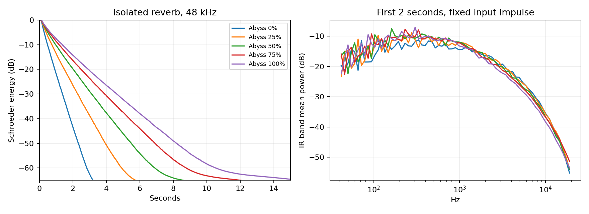
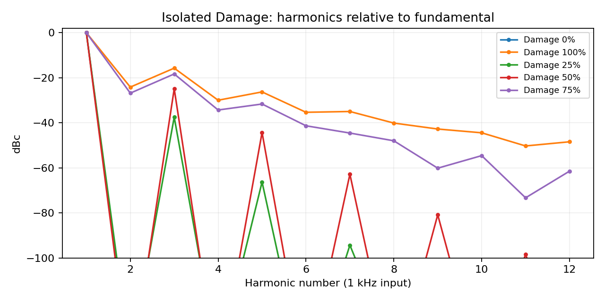
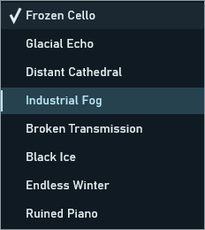

# Audit evidence and audition guide

See [DSP_AUDIT.md](../../DSP_AUDIT.md) for interpretation and [SONIC_ROADMAP.md](../../SONIC_ROADMAP.md) for proposed voicing work. These are measurements and synthetic examples, not listening verdicts.

## Start with the two objective repairs

Use the same monitor gain for each before/after pair:

- [Output automation before](../../renders/audit/before/output_automation.wav) / [after](../../renders/audit/after/output_automation.wav): 100 Hz input, Output −12→0 dB at 0.5 seconds with Mix=0. Before skips the gain ramp; after preserves smoothing. It switches at a zero crossing; this file is an envelope demonstration, not a worst-case click test.
- [Reverb mute before](../../renders/audit/before/muted_reverb_distance.wav) / [after](../../renders/audit/after/muted_reverb_distance.wav): Reverb Level=0 with Distance=1. The late leak is small; view or amplify both tails by the same amount to inspect it. After 0.5 seconds the fixed file is digital silence. The short initial filtered/scattered response belongs to Distance, not a residual reverb return.

`before_after.csv` compares all244 pairs. Only these two files change. Factory voicing and the isolated Damage/reverb algorithms are unchanged.

## Character comparisons

- Original reference: [piano input](../../renders/audit/after/input_piano.wav), [cello input](../../renders/audit/after/input_cello.wav).
- [Init cello](../../renders/audit/after/init_cello.wav), [Industrial Fog cello](../../renders/audit/after/Industrial_Fog_cello.wav), [Endless Winter cello](../../renders/audit/after/Endless_Winter_cello.wav): preserve their actual insertion levels first.
- Common-RMS versions: [Init](../../renders/audit/after/init_cello_rms_minus24.wav), [Industrial Fog](../../renders/audit/after/Industrial_Fog_cello_rms_minus24.wav), [Endless Winter](../../renders/audit/after/Endless_Winter_cello_rms_minus24.wav). Scaling uses the active four-second window at−24 dBFS RMS; this is not perceived-loudness matching.
- [Captured Frozen Cello](../../renders/audit/after/Frozen_Cello_capture_cello.wav) versus [unarmed](../../renders/audit/after/Frozen_Cello_cello.wav). Capture occurs after1.5s and releases at5s. A preset does not contain recorded frozen audio.
- Damage examples follow `damage_{0,25,50,75,100}_sine1000_{-18,-6}_{44100,48000,96000}.wav`, with `_rms_minus24` matched companions. `sine7301` probes foldover. These are isolated Damage, not the complete chain.
- `reverb_{0,25,50,75,100}_{44100,48000,96000}.wav` are40-second **unscaled raw algorithm** impulse responses. In particular, `reverb_0` is not the audible full-chain Abyss0 setting. `chain_ir_{case}.wav` supplies full-chain30-second tails.

All eight presets have piano/cello original-level and matched renders in [the after directory](../../renders/audit/after). The before directory uses identical input generation and timing.

## Data

`matrix.csv`:508 final-output measurements. `stages.csv` is larger and remains beside the WAVs. `macro_map.csv`:40 quarter-step control mappings. `presets.csv`:all34 values for every preset. `harmonics.csv`:H1–H12, THD and non-harmonic residual. `reverb.csv`:energy, T20 estimates, bands, stereo, density proxies and local PSD prominence. `chain_ir.csv`:full-chain early/late energy and late decay fits. `preset_similarity.csv`:same-input waveform comparison, not perceptual redundancy. `analysis_summary.json`:numerical totals and caveats. `binary_hashes.csv`:baseline renderer and new VST3 identifiers.

Reproduce with the commands in the main audit. Full logs: `build/audit/release-validation.log`, `build/Testing/Temporary/LastTest.log`, `build/host-results.txt`, `build/installer-results.txt`. No real user installation was changed by installer tests.
