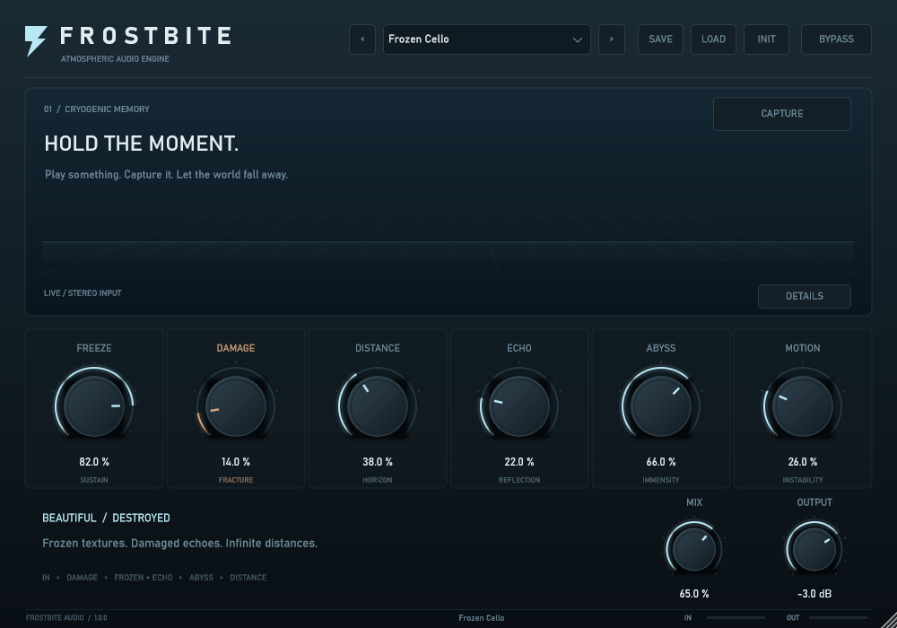

# FROSTBITE

A Windows x64 VST3 effect for held granular textures, dark ping-pong echoes, nonlinear damage and vast stereo ambience. C++20 / JUCE 9.0.4. All six engines process audio; controls use host automation and state persistence.



The release ZIP includes the compiled bundle, `FROSTBITE.exe` for live input, `frostbite_render.exe --audition` for file playback, source code, factory preset files, diagnostic WAVs and installation scripts. Run `.\scripts\install.ps1 -Scope User` from the extracted package to install.

## Build

Install Visual Studio 2022 Build Tools with **Desktop development with C++**, MSVC v143, Windows SDK and C++ CMake tools. Git is required for the pinned JUCE download. From this directory:

```powershell
.\scripts\build.ps1
```

This configures Release x64, compiles the VST3/standalone/tools, runs CTest and the independent VST3 host check, then renders diagnostic WAVs. If script execution is restricted, use `powershell -ExecutionPolicy Bypass -File .\scripts\build.ps1` for that invocation. No machine execution-policy change is required.

Equivalent Developer PowerShell commands:

```powershell
cmake --preset windows-x64
cmake --build --preset release
ctest --preset release
.\build\frostbite_host_check_artefacts\Release\frostbite_host_check.exe "$PWD\build\Frostbite_artefacts\Release\VST3\FROSTBITE.vst3"
.\build\frostbite_render_artefacts\Release\frostbite_render.exe --diagnostics "$PWD\renders"
```

First configure downloads JUCE unless `external/JUCE` exists. The dependency is pinned to 9.0.4; no Python, Node, network or JUCE installation is needed at plugin runtime. MSVC runtime is statically linked.

Output bundle: `build/Frostbite_artefacts/Release/VST3/FROSTBITE.vst3`

Actual PE binary: `build/Frostbite_artefacts/Release/VST3/FROSTBITE.vst3/Contents/x86_64-win/FROSTBITE.vst3`

Standalone: `build/Frostbite_artefacts/Release/Standalone/FROSTBITE.exe`

For just the portable DSP tests: `cmake --preset dsp-only`, then `cmake --build build-dsp --config Release` and `ctest --test-dir build-dsp -C Release --output-on-failure`.

## Install

Close audio hosts and run:

```powershell
.\scripts\install.ps1 -Scope User
```

This verifies and copies the **whole bundle** to `%LOCALAPPDATA%\Programs\Common\VST3\FROSTBITE.vst3`. For the system location `C:\Program Files\Common Files\VST3`, run an Administrator PowerShell and use `-Scope System`. Use `-WhatIf` to preview. Existing installations are refused unless `-Replace` is explicit; only a bundle marked as this project's installation can be replaced, and a backup is retained. No unrelated plugins are deleted.

Some hosts do not scan the user folder automatically. Add it to Studio One's VST locations, or use the system install. [Steinberg's standard locations](https://steinbergmedia.github.io/vst3_dev_portal/pages/Technical%2BDocumentation/Locations%2BFormat/Plugin%2BLocations.html).

## Play

Start with **Frozen Cello**. Play a sustained note for one or two seconds, then press **Capture**. This holds the preceding stereo audio in four overlapping grains. The Freeze macro controls its prominence; **Release** fades it out. Presets do not contain captured recordings.

Six macros shape the sound; Mix blends the original signal and Output trims the final level. **Details** exposes grain controls, tempo/divisions, feedback, reverb, nonlinear character and modulation. Double-click knobs to reset, Shift-drag for finer adjustment, or edit the number. Save/Load uses `.frostbite` XML preset files; the default directory is `%APPDATA%\Frostbite\Presets`.

The JUCE standalone opens an audio device and offers device settings; use headphones when monitoring live input. The render utility also includes a file-audition host with Load Audio, Play, Stop, output-device settings and the same editor:

```powershell
.\build\frostbite_render_artefacts\Release\frostbite_render.exe --audition
```

In the release package, run `.\frostbite_render.exe --audition`. It accepts WAV, AIFF and FLAC, and resamples to the output device rate with linear interpolation. Stop halts the file while effect tails and captured audio continue. Loading a different file resets the processor.

See [audition guide](docs/AUDITION.md), [DSP design](docs/ENGINEERING.md) and [Studio One checklist](docs/STUDIO_ONE_CHECKLIST.md).

## Scope and limitations

- Captured audio is intentionally not saved in presets or DAW projects. Reopening leaves capture off.
- DSP tests, rendered waveforms and host checks establish engineering behavior, not subjective musical quality. First listening/tuning with real instruments remains essential.
- No oversampling; ADAA reduces nonlinear aliasing but does not eliminate it.
- The reported 120-second tail is finite; held granular audio can continue until released.
- V1 has no MIDI control, spectral freeze, preset search or visual node graph.
- macOS builds are unverified. The DSP is portable; on a Mac install Xcode/CMake, configure with Ninja or Xcode, and add `AU` to `FORMATS`. Build/test separately for `arm64;x86_64`, then handle signing, notarization and packaging. No macOS compatibility is claimed.
- Review [dependency licensing](THIRD_PARTY_NOTICES.md) before distribution.

The factual build/test status is recorded in [completion report](docs/COMPLETION.md).
